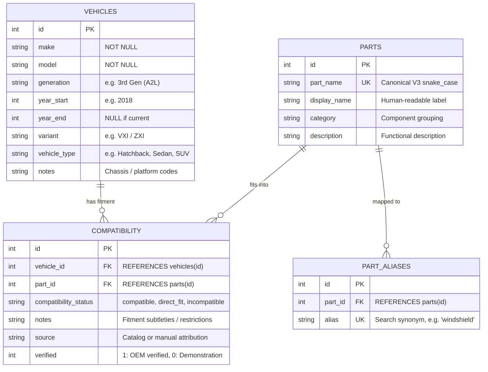

# PartVision AI — Automotive Compatibility Database Developer Guide

## 1. System Overview & Architecture

The `src/database` module implements the relational data layer for PartVision AI. It provides an authoritative, ACID-compliant database to resolve vehicular fitment for detected automotive spare parts.

### Core Architectural Principle: Decoupling Vision from Compatibility

```
  ┌──────────────────────────────┐
  │   PartVision V3 YOLO11n-seg  │  Identifies: WHAT part is visible in the image
  │    (Computer Vision Engine)  │  Example: "front_bumper" (conf: 0.94)
  └──────────────┬───────────────┘
                 │ (Canonical part taxonomy string)
                 ▼
  ┌──────────────────────────────┐
  │   SQLite Compatibility DB    │  Authoritative lookup: WHICH vehicles fit this part?
  │      (data/partvision.db)    │  Determined by verified OEM catalogs, NOT by AI
  └──────────────┬───────────────┘
                 │
                 ▼
  ┌──────────────────────────────┐
  │  Normalized JSON / API Resp  │  Returns: Vehicle compatibility, fitment notes,
  │       (FastAPI Service)      │  data source provenance, and verification status
  └──────────────────────────────┘
```

> **CRITICAL RULE**: Computer vision models cannot and must not hallucinate mechanical fitment, bolt-hole patterns, chassis revisions, or model years. Compatibility is determined strictly by the structured relational database.

---

## 2. Database Engine & Configuration

PartVision AI uses **SQLite 3** configured for high-concurrency read performance and data integrity:

| Configuration Parameter | Setting | Rationale |
| :--- | :--- | :--- |
| **Storage Location** | `data/partvision.db` | Lightweight single-file database residing in the data volume |
| **Journal Mode** | `WAL` (Write-Ahead Logging) | Enables concurrent readers without blocking writes; improves throughput |
| **Foreign Keys** | `ON` (`PRAGMA foreign_keys = ON;`) | Enforces relational integrity and cascading deletes |
| **Synchronous Mode** | `NORMAL` | Optimizes I/O on solid-state and APFS drives while preserving durability |
| **Row Factory** | `sqlite3.Row` | Name-based and index-based dictionary column access |

---

## 3. Relational Schema & Entity-Relationship Model



### Table Definitions

#### `vehicles`
Stores vehicle make, model, generation, year range, and body classification.
```sql
CREATE TABLE vehicles (
    id INTEGER PRIMARY KEY AUTOINCREMENT,
    make TEXT NOT NULL,
    model TEXT NOT NULL,
    generation TEXT,
    year_start INTEGER,
    year_end INTEGER,
    variant TEXT,
    vehicle_type TEXT,
    notes TEXT
);
CREATE INDEX idx_vehicles_make_model ON vehicles(make, model);
```

#### `parts`
Encapsulates all 19 canonical PartVision V3 classes.
```sql
CREATE TABLE parts (
    id INTEGER PRIMARY KEY AUTOINCREMENT,
    part_name TEXT UNIQUE NOT NULL,
    display_name TEXT NOT NULL,
    category TEXT NOT NULL,
    description TEXT
);
CREATE INDEX idx_parts_part_name ON parts(part_name);
```

#### `part_aliases`
Maps search synonyms, colloquial terms, and multi-word variations to canonical parts.
```sql
CREATE TABLE part_aliases (
    id INTEGER PRIMARY KEY AUTOINCREMENT,
    part_id INTEGER NOT NULL,
    alias TEXT UNIQUE NOT NULL,
    FOREIGN KEY (part_id) REFERENCES parts(id) ON DELETE CASCADE
);
CREATE INDEX idx_part_aliases_alias ON part_aliases(alias);
```

#### `compatibility`
Maps vehicles to parts with explicit fitment status, technical notes, and verification provenance.
```sql
CREATE TABLE compatibility (
    id INTEGER PRIMARY KEY AUTOINCREMENT,
    vehicle_id INTEGER NOT NULL,
    part_id INTEGER NOT NULL,
    compatibility_status TEXT NOT NULL,
    notes TEXT,
    source TEXT NOT NULL,
    verified INTEGER NOT NULL DEFAULT 0,
    FOREIGN KEY (vehicle_id) REFERENCES vehicles(id) ON DELETE CASCADE,
    FOREIGN KEY (part_id) REFERENCES parts(id) ON DELETE CASCADE,
    UNIQUE(vehicle_id, part_id)
);
CREATE INDEX idx_compatibility_vehicle_part ON compatibility(vehicle_id, part_id);
CREATE INDEX idx_compatibility_part_vehicle ON compatibility(part_id, vehicle_id);
```

---

## 4. Part Taxonomy & Categories

The database seeds all 19 PartVision V3 classes without modification:

| ID | Canonical Name | Human Display Name | Functional Category |
| :---: | :--- | :--- | :--- |
| 1 | `back_bumper` | Back Bumper | Exterior Body |
| 2 | `back_door` | Back Door | Exterior Body |
| 3 | `back_glass` | Back Glass | Exterior Glass |
| 4 | `back_light` | Back Light | Lighting |
| 5 | `fender` | Fender | Exterior Body |
| 6 | `front_bumper` | Front Bumper | Exterior Body |
| 7 | `front_door` | Front Door | Exterior Body |
| 8 | `front_glass` | Front Glass | Exterior Glass |
| 9 | `front_light` | Front Light | Lighting |
| 10 | `grille` | Grille | Exterior Body |
| 11 | `hood` | Hood | Exterior Body |
| 12 | `mirror` | Mirror | Mirrors |
| 13 | `quarter_panel` | Quarter Panel | Exterior Body |
| 14 | `rocker_panel` | Rocker Panel | Exterior Body |
| 15 | `roof` | Roof | Exterior Body |
| 16 | `side_window` | Side Window | Exterior Glass |
| 17 | `tailgate` | Tailgate | Exterior Body |
| 18 | `trunk` | Trunk | Exterior Body |
| 19 | `wheel` | Wheel | Wheels |

---

## 5. Seed Vehicles Catalog (Indian Market)

The database includes 8 representative Indian-market vehicles spanning hatchbacks, sedans, SUVs, and MPVs across generations and facelifts:

| ID | Make | Model | Generation | Years | Body Type |
| :---: | :--- | :--- | :--- | :--- | :--- |
| 1 | Maruti Suzuki | Swift | 3rd Gen (A2L) | 2018–2024 | Hatchback |
| 2 | Maruti Suzuki | Swift | 4th Gen (Z-Series) | 2024–Present | Hatchback |
| 3 | Hyundai | Creta | 2nd Gen (SU2i Pre-facelift) | 2020–2023 | Compact SUV |
| 4 | Hyundai | Creta | 2nd Gen (SU2i Facelift) | 2024–Present | Compact SUV |
| 5 | Tata | Nexon | 1st Gen (Facelift 2) | 2023–Present | Compact SUV |
| 6 | Mahindra | Scorpio-N | 1st Gen (Z-Series) | 2022–Present | Mid-size SUV |
| 7 | Toyota | Innova Crysta | 2nd Gen (AN140) | 2016–Present | MPV |
| 8 | Honda | City | 5th Gen | 2020–Present | Sedan |

---

## 6. Python Developer API (`PartVisionRepository`)

The `PartVisionRepository` class in `src/database/repository.py` provides high-level typed access using Pydantic models.

### Basic Usage

```python
from src.database.repository import PartVisionRepository

repo = PartVisionRepository()

# 1. Normalize user/AI text to canonical part name
canonical = repo.normalize_part_name("windshield")
print(canonical)  # "front_glass"

# 2. Look up compatible vehicles for a detected part
vehicles = repo.get_compatible_vehicles("front_bumper", verified_only=True)
for item in vehicles:
    print(f"{item.vehicle.make} {item.vehicle.model}: {item.compatibility_status}")

# 3. Look up all parts for a vehicle
parts = repo.get_compatible_parts(vehicle_id=1)
for item in parts:
    print(f"{item.part.display_name}: {item.compatibility_status} (Source: {item.source})")

# 4. Check specific pair compatibility
fitment = repo.check_compatibility(vehicle_id=8, part_name="trunk")
if fitment:
    print(f"Status: {fitment.compatibility_status}, Notes: {fitment.notes}")
```

---

## 7. Data Verification & Integrity Rules

1. **Source Attribution**: Every record in `compatibility` has a non-null `source` referencing an OEM parts catalog, collision manual, or demonstration fixture.
2. **Verification Flag (`verified`)**:
   - `1`: Verified against OEM parts manuals (e.g., Maruti Suzuki Genuine Parts, Hyundai Mobis, Honda Access).
   - `0`: Demonstration records (e.g., aftermarket side skirts, off-road flares).
3. **Automotive Body Style Rules**:
   - Three-box sedans (e.g., Honda City) have `trunk` (compatible) and `tailgate` (incompatible).
   - Two-box hatchbacks and SUVs (e.g., Swift, Creta) have `tailgate` (compatible) and `trunk` (incompatible).
4. **Generational Rules**:
   - Pre-facelift and post-facelift bumpers/grilles carry distinct generational fitment notes preventing cross-year mismatching.

---

## 8. CLI Scripts & Utilities

- **Seed Database**:
  ```bash
  python scripts/init_database.py
  ```
- **Integrity Validation (12 Audit Checks)**:
  ```bash
  python scripts/validate_database.py
  ```
- **CLI Interactive Demo**:
  ```bash
  python scripts/demo_database.py
  ```
- **Run Automated Test Suite**:
  ```bash
  pytest tests/test_database.py
  ```

---

## 9. Migration & Scaling Roadmap

- **Production API Integration (Milestone 7)**: FastAPI route handlers will inject `PartVisionRepository` to hydrate computer-vision detections with real-time vehicle fitment data.
- **Enterprise Database Scaling**: The clean DAO interface allows swapping the underlying SQLite storage for PostgreSQL / Supabase in high-scale multi-tenant environments without modifying upstream inference or business logic.
