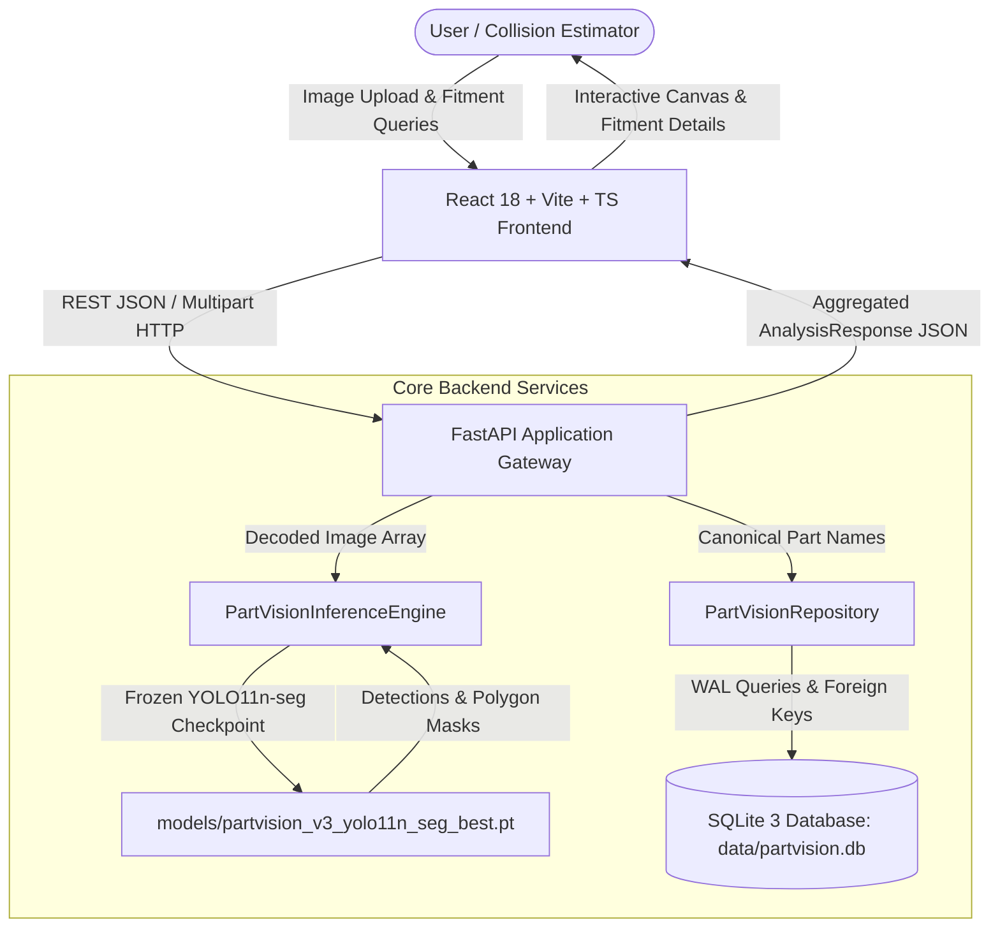
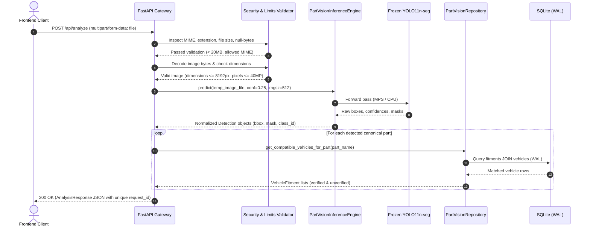

# PartVision AI — System Architecture & Design Specification

**Document Version:** 1.0.0  
**Target Release:** Milestone 9 Integration & Production Hardening  
**Platform:** macOS Darwin 27.0.0 (Apple Silicon M3), Python 3.13.2, Node 24.15.0  

---

## 1. System Overview & Executive Summary

**PartVision AI** is an enterprise-grade automotive spare-part visual identification and vehicle compatibility resolution system. Built for automotive technicians, collision repair estimators, parts distributors, and vehicle owners, the platform converts raw vehicle imagery into verified component identifications and OEM/aftermarket compatibility mappings in sub-200 milliseconds.



---

## 2. Core Architectural Principles

1. **Strict Separation of Vision and Compatibility (The Ground Truth Invariant):**
   - The computer vision model (YOLO11n-seg) is responsible *exclusively* for visual localization (bounding boxes), instance segmentation (polygons), and category classification into the 19 canonical body/lighting classes.
   - The vision model **never** determines or guesses vehicle make, model, year, or interchangeability.
   - The SQLite database is the single authoritative source of truth for automotive fitment.
2. **Zero Generative Hallucination Policy:**
   - Large Language Models (LLMs) or generative text models are strictly prohibited from inventing fitment relationships or generating compatibility notes.
   - All vehicle fitment records must map to verified OEM catalogs (e.g., Maruti Suzuki Genuine Parts, Hyundai Mobis, Honda Access, Tata Motors) or explicit aftermarket interchange manuals.
3. **Model & Taxonomy Immutability:**
   - The trained YOLO11n-seg V3 model checkpoint (`models/partvision_v3_yolo11n_seg_best.pt`, SHA256: `83b37812af49c90f5788571cb7b3fc29f0c39b5b21427f7597289c2520bd4394`) is completely frozen.
   - The 19-class canonical taxonomy (`back_bumper`, `back_door`, `back_glass`, `back_light`, `fender`, `front_bumper`, `front_door`, `front_glass`, `front_light`, `grille`, `hood`, `mirror`, `quarter_panel`, `rocker_panel`, `roof`, `side_window`, `tailgate`, `trunk`, `wheel`) is fixed and immutable.
4. **Relational & Transactional Integrity:**
   - Database operations enforce SQLite WAL (Write-Ahead Logging) mode and foreign-key constraints (`PRAGMA foreign_keys = ON; PRAGMA journal_mode = WAL;`).
   - Normalization prevents duplicate records; many-to-many fitments use strict composite primary keys with cascading deletes.

---

## 3. Component Architecture & System Boundaries

### 3.1 Presentation Layer: React Single-Page Application (`frontend/`)
- **Technology Stack:** React 18.3.1, TypeScript 5.7.2, Vite 6.0.3, Tailwind CSS 3.4.17, Phosphor Icons (`@phosphor-icons/react`), Framer Motion.
- **Key Components:**
  - `ImageCanvas`: High-performance HTML5 2D canvas supporting image rendering, bounding box overlays, color-coded segmentation masks, hover states, and click-to-select interaction.
  - `AnalysisDashboard`: Split-screen layout displaying analyzed image, detection counts, confidence meters, and contextual fitment cards.
  - `FitmentDrawer / FitmentList`: Displays vehicle compatibility segregated into OEM-verified and unverified/aftermarket categories with technical notes (e.g. PCD, bolt patterns).
  - `PartsCatalogPage` & `VehicleCatalogPage`: Searchable, filterable exploratory catalogs for all 19 supported parts and vehicle models.
- **Routing & State Management:** Lightweight HTML5 history-synchronized navigation (`pushState` / `popstate`) without external routing bloat, maintaining deep links (`/parts`, `/parts/:partName`, `/vehicles`, `/vehicles/:vehicleId`, `/about`) and dedicated 404 handling.

### 3.2 Application Gateway: FastAPI REST Backend (`src/api/`)
- **Technology Stack:** FastAPI 0.115+, Uvicorn 0.34+, Pydantic V2 (`pydantic.BaseModel` with `extra="forbid"`).
- **Lifespan Management:**
  - Single-load initialization: At application startup, loads the SQLite database repository and warms up the frozen YOLO model on the optimal device (Apple Silicon `mps` or `cuda`/`cpu`).
  - Warm state persists across all requests in `app.state`, eliminating cold-start latency.
- **Exception Sanitization:** Global exception handlers capture `RequestValidationError`, `HTTPException`, and generic exceptions, returning clean standardized JSON structures (`{"error": str, "detail": str}`) with **zero traceback leakage**.

### 3.3 Inference Engine Service (`src/inference/`)
- **Technology Stack:** Ultralytics YOLO11n-seg, PyTorch 2.4.1 (MPS accelerated), OpenCV 4.10+.
- **Engine Core (`PartVisionInferenceEngine`):**
  - Thread-safe image preprocessing and byte decoding.
  - Resolution normalization (`imgsz=512`), confidence filtering (`conf=0.25`), IoU suppression (`iou=0.7`).
  - Coordinate re-scaling and integer clamping from inference scale back to original image space.
  - Geometry validation ensuring non-inverted boxes ($x_1 < x_2$, $y_1 < y_2$) and closed polygon contours.

### 3.4 Persistence & Compatibility Repository (`src/database/`)
- **Database Engine:** SQLite 3.45+ located at `data/partvision.db`.
- **Relational Schema:**
  - `vehicles`: id, make, model, generation, year_start, year_end, variant, vehicle_type, notes.
  - `parts`: id, part_name (UNIQUE canonical key), display_name, category, description.
  - `vehicle_parts_compatibility`: id, vehicle_id, part_id, compatibility_status, is_verified, notes, source.
  - `part_aliases`: id, part_id, alias (fuzzy matching support).
- **Repository Pattern (`PartVisionRepository`):**
  - Thread-safe connection context management (`sqlite3.connect`).
  - Normalized part name resolution supporting synonym mapping (e.g., `bonnet` $\to$ `hood`, `windshield` $\to$ `front_glass`, `headlight` $\to$ `front_light`).

---

## 4. End-to-End Data Flows

### 4.1 Image Analysis & Compatibility Pipeline (`POST /api/analyze`)



---

## 5. Security & Resource Hardening Architecture

1. **Upload Boundaries & Payload Limits:**
   - **Maximum File Size:** 20 MB enforced before memory buffering (`HTTP 413 Payload Too Large`).
   - **Allowed Formats:** `.jpg`, `.jpeg`, `.png`, `.webp` and corresponding MIME types enforced (`HTTP 415 Unsupported Media Type`).
   - **Null Byte Injection Defense:** Both raw null bytes (`\x00`) and URL-encoded null bytes (`%00`) in filenames trigger instant rejection (`HTTP 400 Bad Request`).
   - **Path Traversal Defense:** Uploaded filenames are stripped to base names (`Path(filename).name`), preventing directory traversal attacks.
2. **Decompression Bomb Protection:**
   - Uncompressed raster decompression limits:
     - `MAX_IMAGE_DIMENSION = 8192` (Width or Height).
     - `MAX_IMAGE_PIXELS = 40_000_000` (40 Megapixels).
   - Images exceeding these limits are halted before processing to prevent memory exhaustion and denial-of-service.
3. **Safe Temporary File Lifecycle:**
   - Images are written to isolated `tempfile.NamedTemporaryFile` instances.
   - A deterministic `finally:` block unlinks and destroys temporary files upon request completion or failure, guaranteeing **zero disk leaks**.
4. **Error Sanitization & Zero Traceback Leakage:**
   - Client-facing error responses conform to strict schema:
     ```json
     {
       "error": "ClientError | ValidationError | NotFoundError | InternalServerError",
       "detail": "Descriptive user-safe message"
     }
     ```
   - Python internal tracebacks and system paths are never returned in HTTP responses.

---

## 6. Performance & Scalability Characteristics

Benchmarked on Apple Silicon M3 (Darwin 27.0.0 arm64) using local PyTorch MPS acceleration:

| Operation Phase | Mean Latency | P50 Latency | P95 Latency |
| :--- | :--- | :--- | :--- |
| **Image Byte Decoding (OpenCV)** | 11.24 ms | 11.20 ms | 11.46 ms |
| **Model Forward Pass (YOLO11n-seg MPS)** | 74.49 ms | 71.43 ms | 89.04 ms |
| **SQLite Fitment Lookup (WAL Mode)** | 33.05 ms | 33.59 ms | 34.11 ms |
| **Pydantic Response Serialization** | 1.76 ms | 1.75 ms | 1.84 ms |
| **End-to-End API Request** | **148.15 ms** | **146.79 ms** | **160.25 ms** |

### Concurrency Stress Testing
- **1 Worker:** 8 / 8 requests succeeded (Avg: 157.92 ms, P95: 222.05 ms).
- **2 Workers:** 8 / 8 requests succeeded (Avg: 268.90 ms, P95: 294.51 ms).
- **4 Workers:** 8 / 8 requests succeeded (Avg: 442.88 ms, P95: 684.92 ms).
- **8 Workers:** 16 / 16 requests succeeded (Avg: 916.39 ms, P95: 1,315.27 ms).
- **Overall Success Rate:** **100% (0 errors, 0 timeouts, 0 database locks)**.
